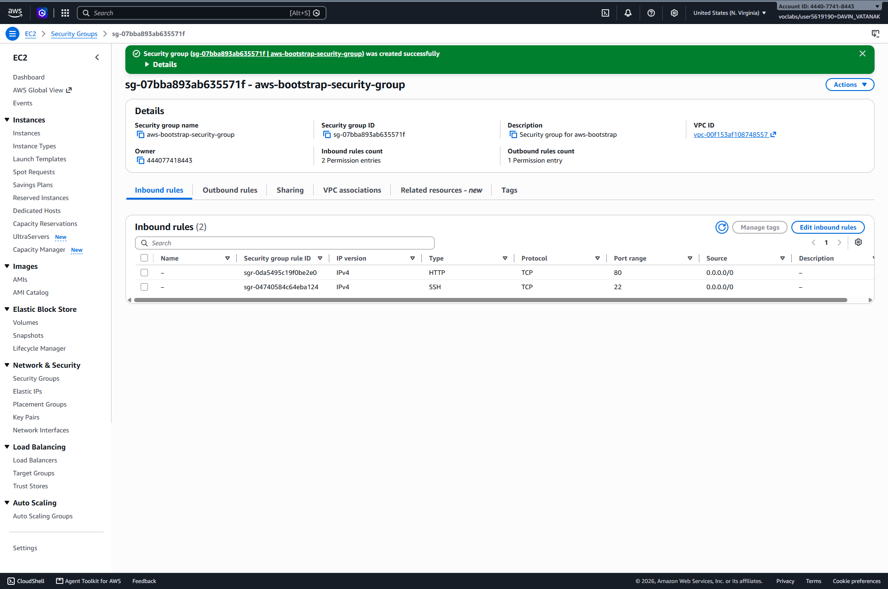
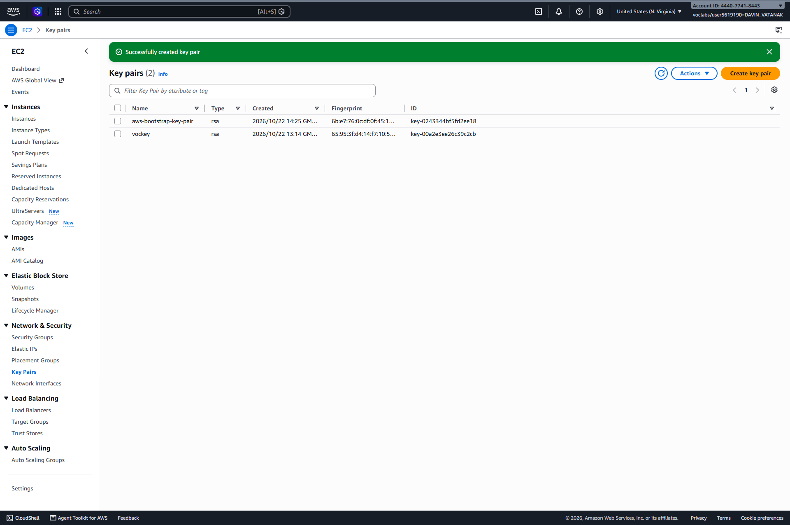
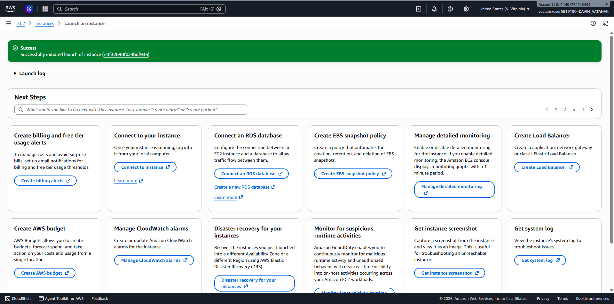
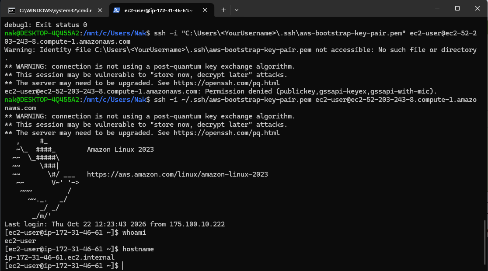
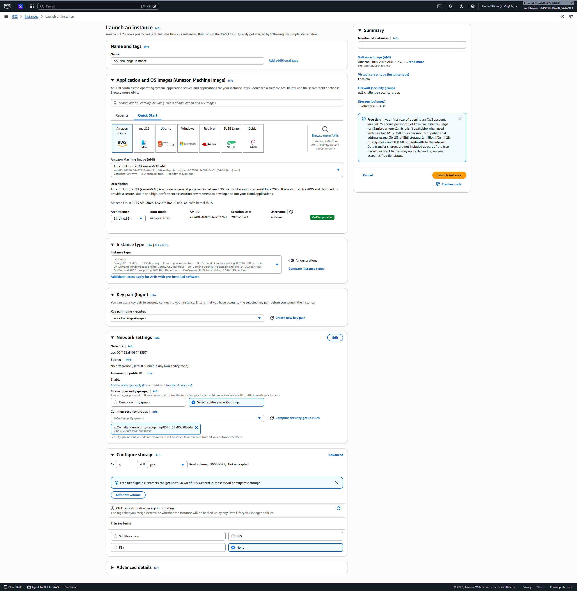
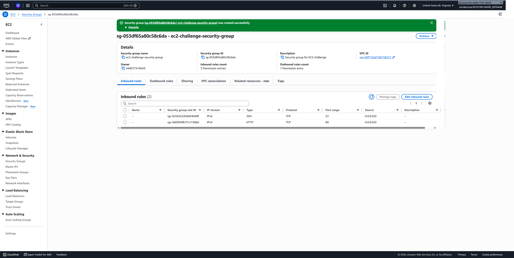
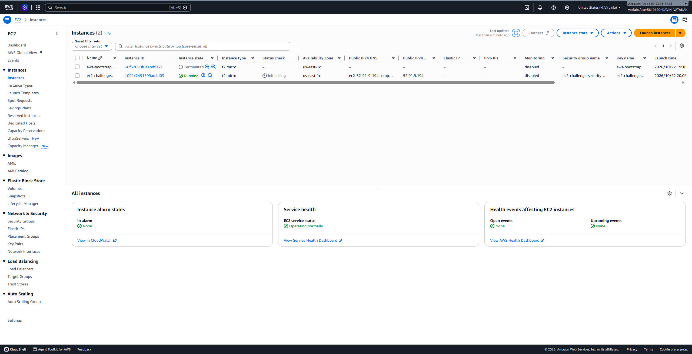
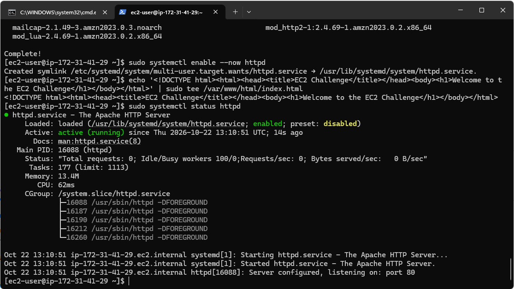
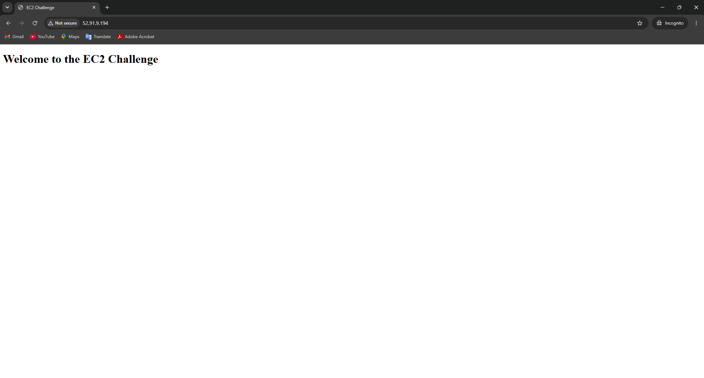

# Cloud Lab 1 Submission — Amazon EC2

- **Student name: Davin Vatanak**
- **Student ID: e20220234**
- **Learner Lab user name: DAVIN_VATANAK**
- **Date completed: 22.10.26**

---

## Part 1.1 — An Amazon EC2 Walkthrough

### Security group



### Key pair



### Instance details



### Browser test


### SSH connection



I connected using my own SSH client through WSL, with the instance's public IP address and my key pair.

---

## Part 1.2 — EC2 Web Solution (Challenge)

### Launch configuration



### Security group



### Running instance



### Commands on the instance



Paste the commands you ran to install the web server and create `index.html`:

```bash
sudo dnf update -y
sudo dnf install -y httpd
sudo systemctl enable --now httpd
echo '<!DOCTYPE html><html><head><title>EC2 Challenge</title></head><body><h1>Welcome to the EC2 Challenge</h1></body></html>' | sudo tee /var/www/html/index.html
sudo systemctl status httpd

```

### Browser test



---

## Questions

1. **SSH and HTTP rules:** The SSH rule allows remote terminal access to the instance over TCP port 22 from the permitted source. The HTTP rule allows web traffic over TCP port 80. Without the HTTP rule, users could not reach the website through the instance's public IP address.
2. **Web server installation:** The EC2 user data script installed and started the web server. EC2 ran the script during the instance's first boot, so I did not need to log in to install it manually.
3. **HTTP but not HTTPS:** The web server was configured to serve the page over HTTP, but HTTPS requires TLS configuration and a certificate. Since those were not set up, the page works with `http://` but not `https://`.
4. **8 GiB root volume:** I set the root volume size to 8 GiB in the instance launch settings under **Configure storage**. I can verify it in the instance's **Storage** tab in the EC2 console or by running `lsblk` on the instance.

## Problems and how I solved them (optional)

The page did not load over `https://` because HTTPS/TLS was not configured on the instance. I opened it with `http://` instead, which worked with the HTTP security group rule.

## AI note (optional)

An AI tool suggested checking that the security group allowed HTTP traffic on port 80. I checked the inbound rules and confirmed the website loaded over `http://`.

## Clean up

- [x] Part 1.1: instance terminated, key pair and security group deleted.
- [x] Part 1.2: instance terminated, security group (and key pair, if any) deleted.