# Cloud Lab 2 Submission — Application Load Balancer and Auto Scaling Group

- **Student name: Davin Vatanak**
- **Student ID: e20220234**
- **Learner Lab user name: DAVIN_VATANAK**
- **Region: US East (N. Virginia) — `us-east-1`**
- **Date completed: [05.11.26]**

---

## Lab objectives

This lab demonstrates how to:

1. Explain what a load balancer, target group, and health check do.
2. Create security groups for an Application Load Balancer and EC2 instances.
3. Create an Application Load Balancer with an HTTP listener and target group.
4. Create a launch template and an Auto Scaling group attached to the load balancer.
5. Test load balancing and observe replacement of an unhealthy instance.

## Resources created

| Resource | Configuration |
|---|---|
| Load balancer security group | `LoadBalancerSecurityGroup`, HTTP port 80 from Anywhere-IPv4 |
| Launch template security group | `LaunchTemplateSecurityGroup`, HTTP port 80 and SSH port 22 from Anywhere-IPv4 |
| Target group | `LoadBalancerTargetGroup`, HTTP port 80, health check path `/` |
| Application Load Balancer | `MyLoadBalancer`, internet-facing, IPv4 |
| Launch template | `AutoScalingLaunchTemplate`, Amazon Linux 2023, `t2.micro` |
| Auto Scaling group | `MyAutoScalingGroup`, desired 2, minimum 2, maximum 3 |

---

## Task 1 — Security groups

### Load balancer security group

`LoadBalancerSecurityGroup` allows incoming HTTP traffic on port 80 from Anywhere-IPv4. The load balancer uses this rule to receive web requests.

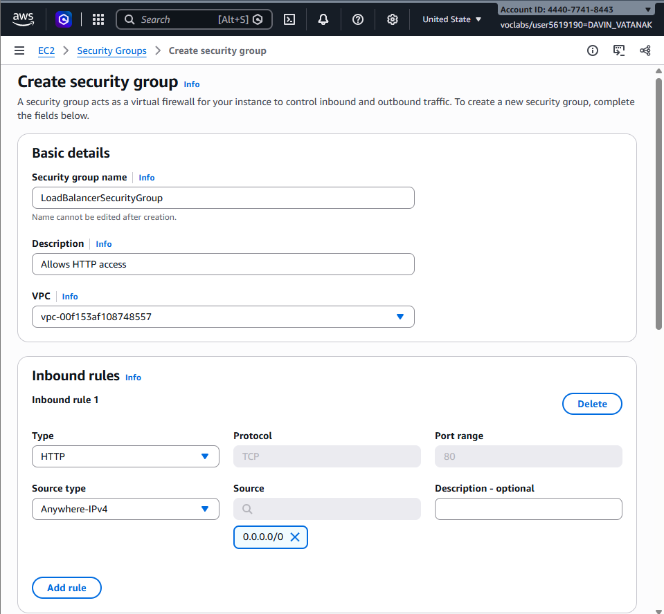

### Launch template security group

`LaunchTemplateSecurityGroup` allows incoming HTTP traffic on port 80 and SSH traffic on port 22 from Anywhere-IPv4. EC2 instances use these rules to serve HTTP requests and allow administrative access.

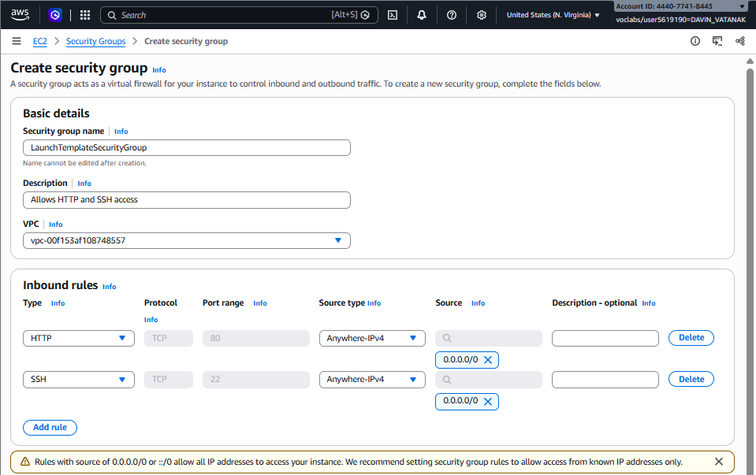

---

## Task 2 — Target group

The target group is named `LoadBalancerTargetGroup`. It forwards HTTP traffic on port 80 to EC2 instances in the default VPC.

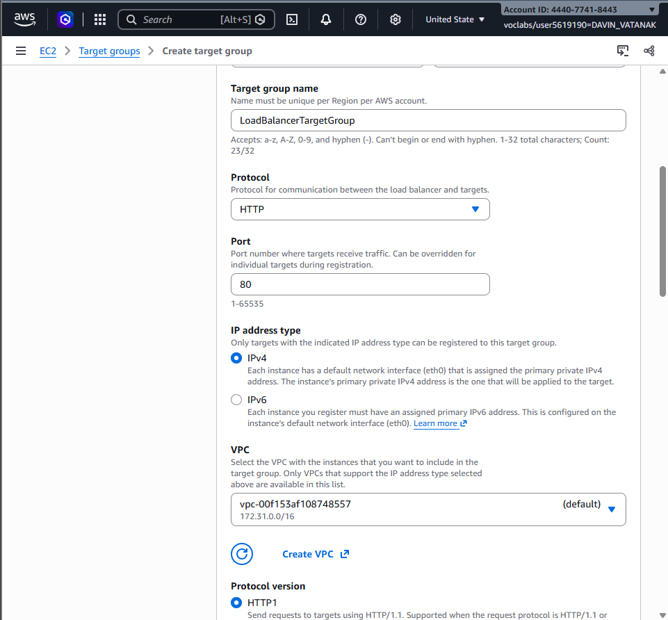

### Health checks

The target group uses HTTP health checks on path `/` every 30 seconds. A successful response is HTTP status code 200. After two consecutive failed checks, a target becomes unhealthy and is removed from service.

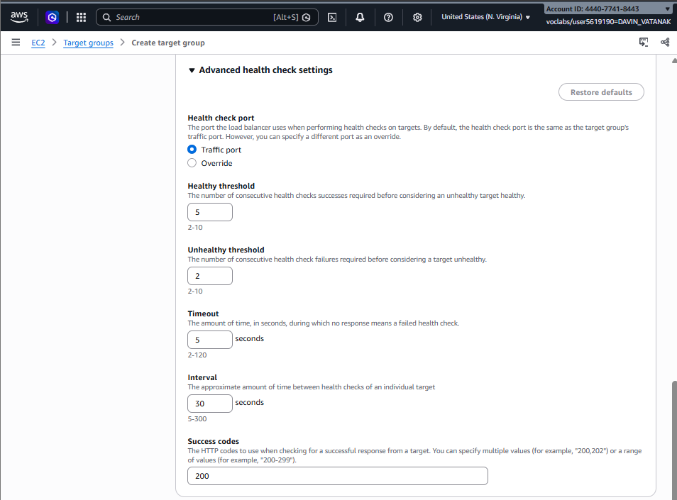

---

## Task 3 — Application Load Balancer

`MyLoadBalancer` is an internet-facing Application Load Balancer using IPv4. It uses `LoadBalancerSecurityGroup` and listens for HTTP traffic on port 80. Its default listener action forwards requests to `LoadBalancerTargetGroup`.

### Load balancer list


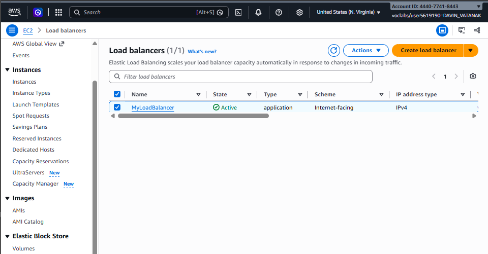

### Load balancer details

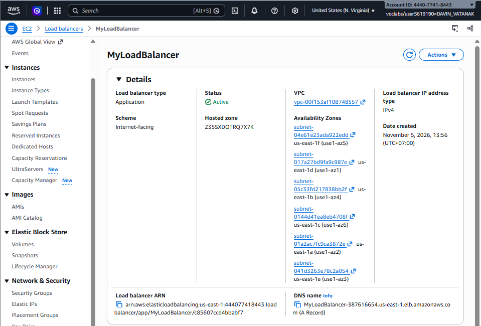

---

## Task 4 — Auto Scaling group

### Launch template

`AutoScalingLaunchTemplate` launches Amazon Linux 2023 `t2.micro` instances using `LaunchTemplateSecurityGroup`.

User data used to install and start Apache HTTP Server and create a page containing the instance hostname:

```bash
#!/bin/bash
# Enabling admin rights
sudo su
# Updating system and installing httpd
yum update -y
yum install -y httpd.x86_64
# Launching a simple httpd server
systemctl start httpd.service
systemctl enable httpd.service
# Writing HTML file to serve on the httpd server
echo "Hello World from ($(hostname))" > /var/www/html/index.html
```

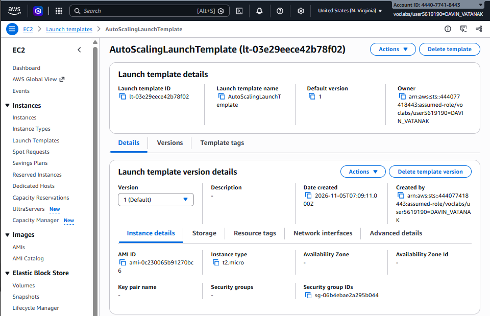

### Auto Scaling group

`MyAutoScalingGroup` uses `AutoScalingLaunchTemplate` and spans all available Availability Zones in the default VPC. It is attached to `LoadBalancerTargetGroup` with Elastic Load Balancing health checks enabled.

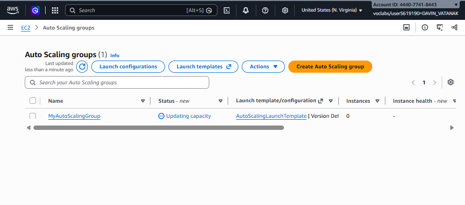

The group capacity settings are:

- **Desired capacity:** 2
- **Minimum capacity:** 2
- **Maximum capacity:** 3
- **Target group:** `LoadBalancerTargetGroup`

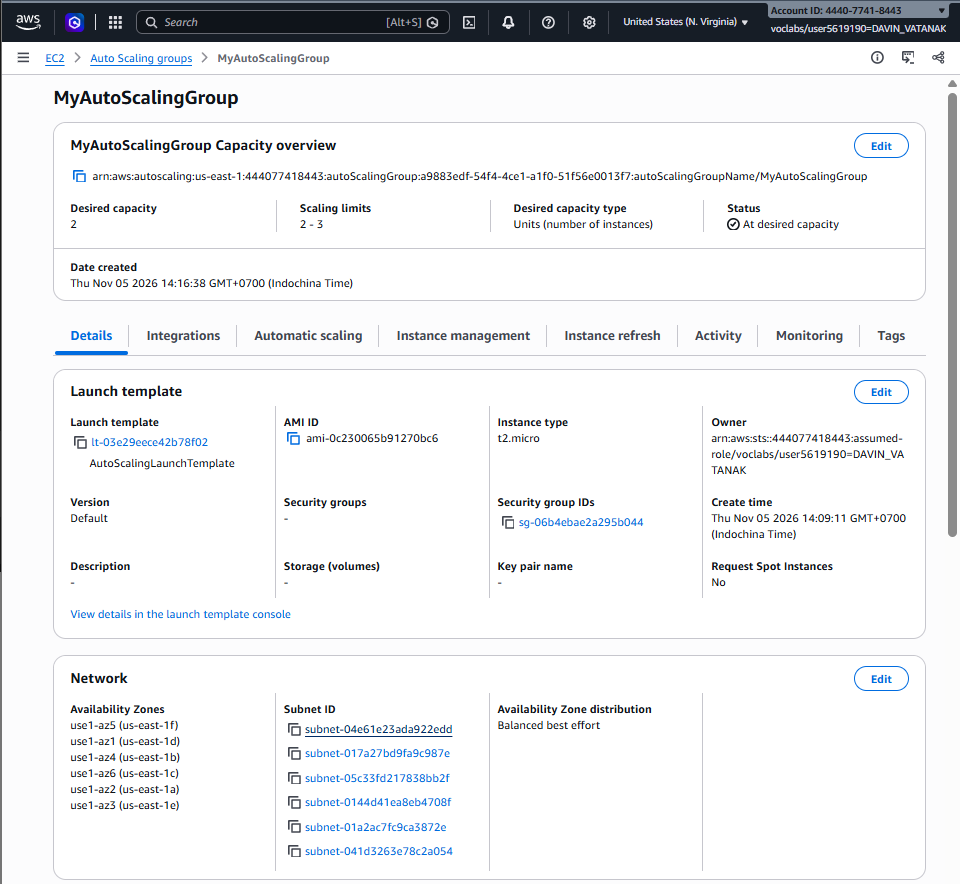

---

## Task 5 — Testing and failure replacement

### Load balancing test

The load balancer DNS name returned the web page from one EC2 instance.


After refreshing the same URL, the load balancer returned the page from a different instance hostname. This demonstrates traffic distribution across healthy targets.

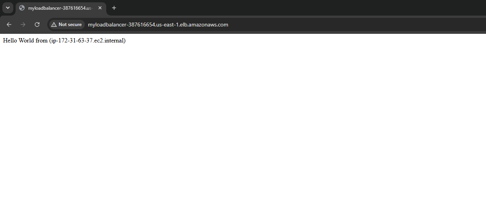

### Simulated application failure

The HTTP server was stopped on one running instance with:

```bash
sudo systemctl stop httpd.service
```

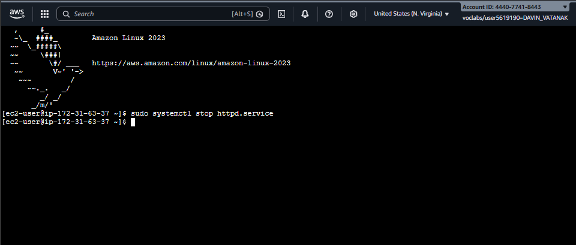

The target group health check detected that the instance no longer returned a valid response on HTTP port 80. The target became unhealthy or draining and was removed from load balancing.

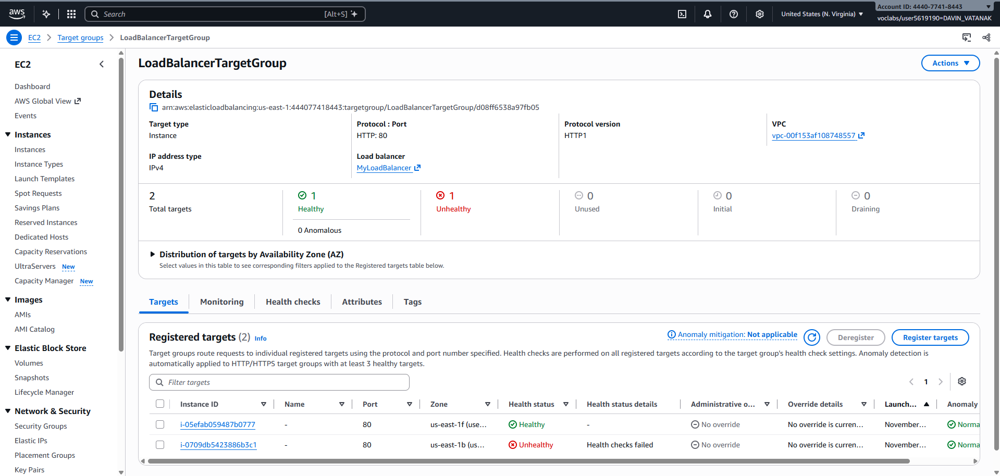

The Auto Scaling group launched a replacement instance. After passing health checks, the new instance became healthy and was registered in the target group.

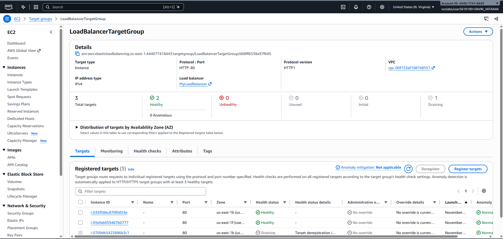

---

## Questions

1. **What does a load balancer do?**  
   An Application Load Balancer provides one public endpoint and distributes incoming HTTP requests across healthy registered EC2 targets. It also performs health checks and stops sending traffic to unhealthy targets.

2. **What does a target group do?**  
   A target group is a logical group of EC2 instances that receives traffic from the load balancer. It defines the target protocol, target port, and health-check settings.

3. **What does a health check do?**  
   The health check requests the configured path from each target at regular intervals. A target that fails enough consecutive checks is marked unhealthy and removed from service.

4. **Why are two security groups used?**  
   `LoadBalancerSecurityGroup` controls traffic entering the load balancer. `LaunchTemplateSecurityGroup` controls traffic entering the EC2 instances. Separating them limits each resource's network access to its required ports.

5. **Why did the hostname change after refreshing the browser?**  
   The load balancer forwarded requests to different healthy EC2 instances. Each instance generated the response using its own hostname.

6. **Why was a replacement instance launched after stopping `httpd`?**  
   Stopping `httpd` caused the instance to fail the target group's HTTP health checks. Because Elastic Load Balancing health checks were enabled for the Auto Scaling group, the unhealthy instance was deregistered and replaced to maintain the minimum capacity.

