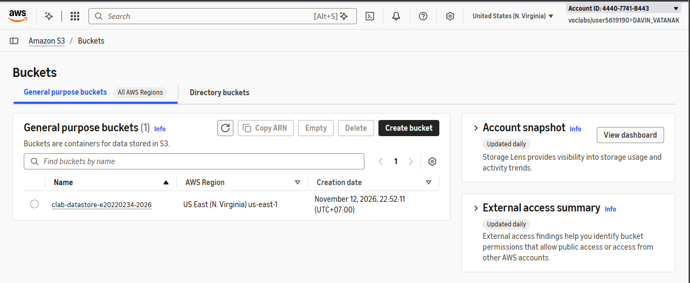
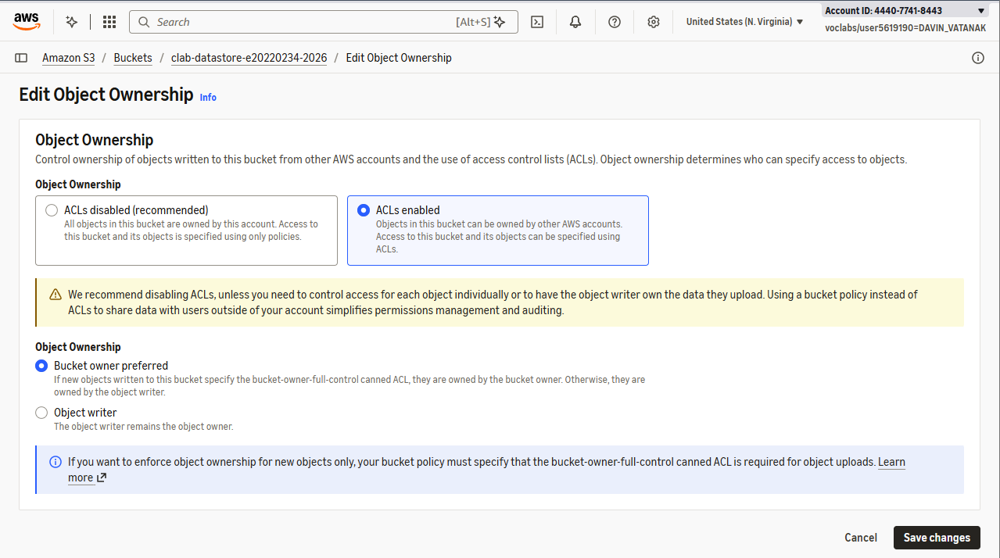
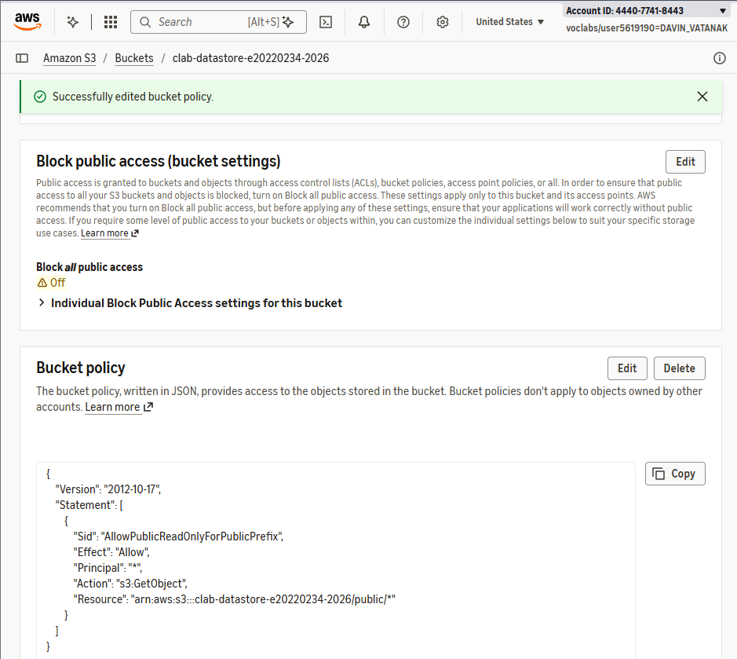
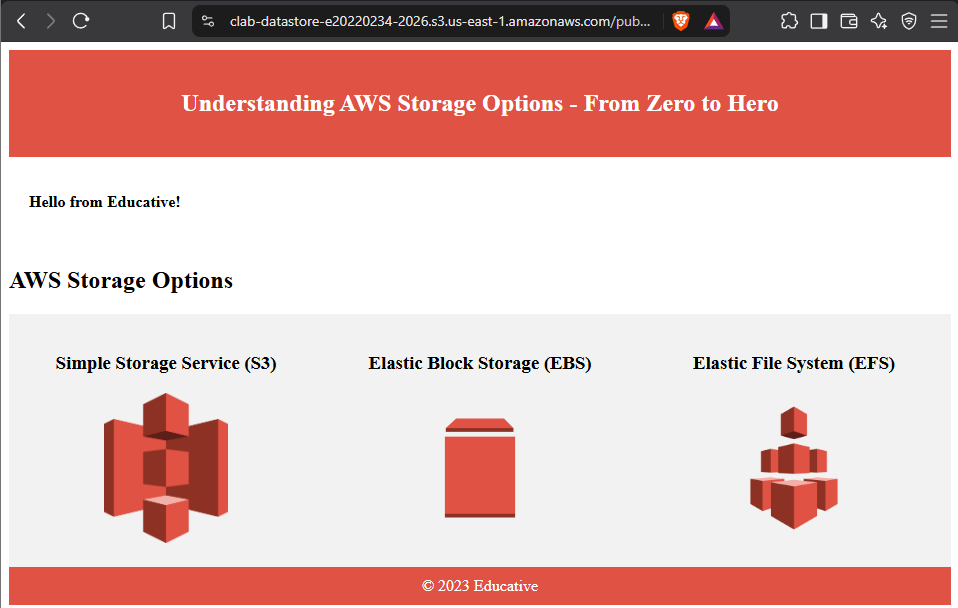
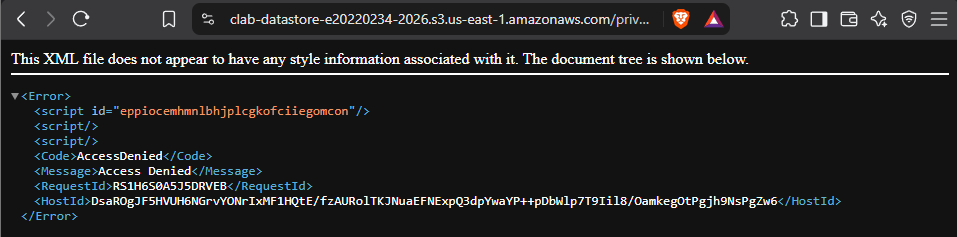
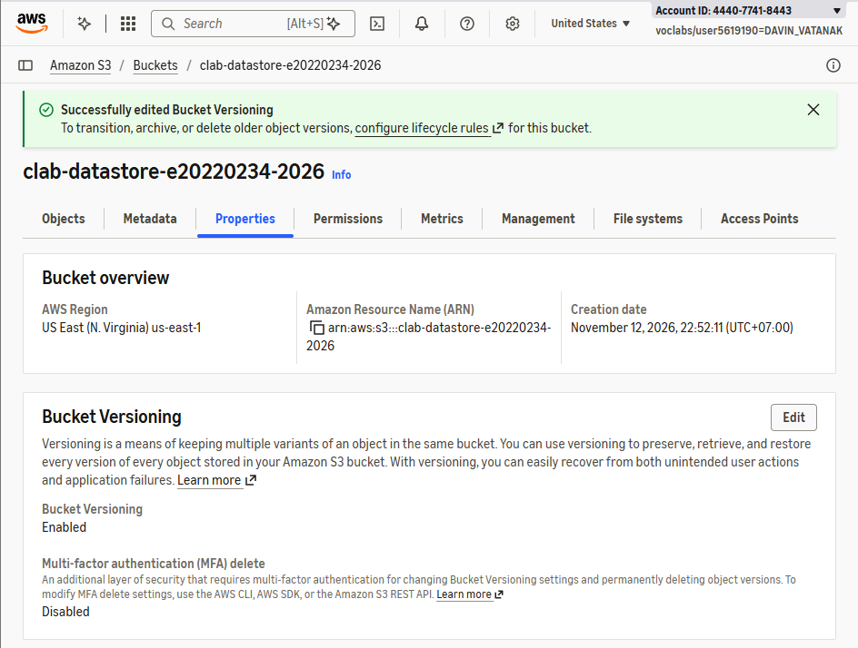
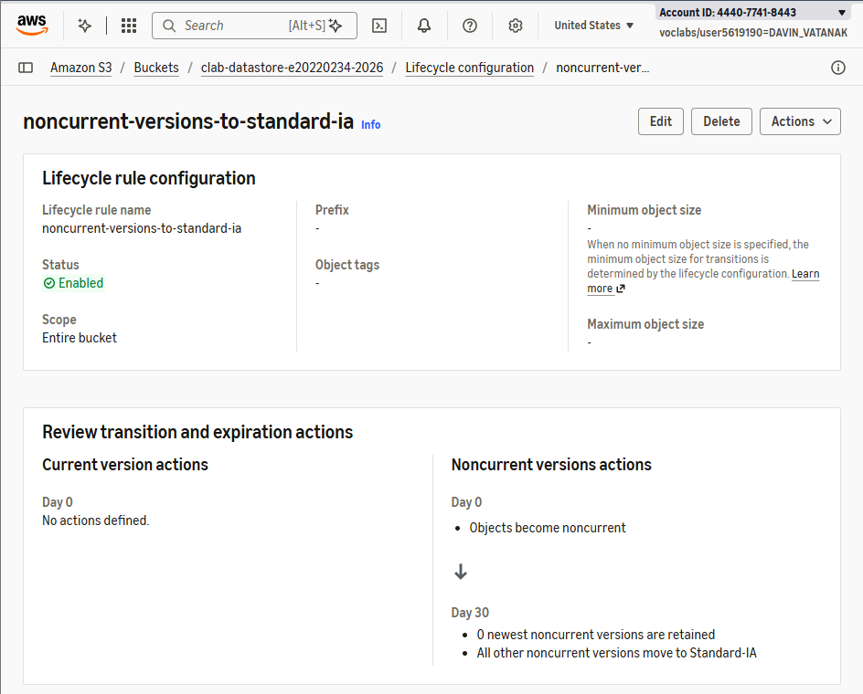

# Cloud Lab 3 Challenge — Secure and Manage an Amazon S3 Bucket

- **Student name:** Davin Vatanak
- **Student ID:** e20220234
- **Learner Lab user name:** DAVIN_VATANAK
- **Region:** US East (N. Virginia) — `us-east-1`
- **Date completed:** 12.11.26

---

## Challenge objectives

This challenge demonstrates how to:

1. Create and configure an Amazon S3 bucket.
2. Configure bucket ownership and ACL settings.
3. Allow public access only to objects in the `public/` prefix.
4. Keep objects outside `public/` private.
5. Enable object versioning.
6. Create a lifecycle rule for noncurrent object versions.

## Resources created

| Resource | Configuration |
|---|---|
| S3 bucket | `clab-datastore-e20220234-2026` in `us-east-1` |
| Object ownership | Bucket owner preferred; ACLs enabled |
| Public prefix | `public/` |
| Public object | `public/index.html` |
| Private object | Root-level test object outside `public/` |
| Versioning | Enabled |
| Lifecycle rule | All objects; noncurrent versions transition to S3 Standard-IA after 30 days |

---

## Task 1 — Provision the S3 bucket

Created a uniquely named S3 bucket beginning with `clab-datastore`.



## Task 2 — Configure object ownership and security

Configured the bucket with:

- Object ownership: **Bucket owner preferred**
- ACLs: **Enabled**
- Block Public Access: configured to allow the required bucket policy



## Task 3 — Implement public access policy

Created the `public/` folder and uploaded `index.html` inside it.

The bucket policy allows `s3:GetObject` only for:

```text
arn:aws:s3:::clab-datastore-e20220234-2026/public/*
```

The complete policy is saved in [`bucket-policy.json`](bucket-policy.json).



The public object loaded successfully through its S3 object URL:

```text
https://clab-datastore-e20220234-2026.s3.us-east-1.amazonaws.com/public/index.html
```



An object outside the `public/` prefix was denied when opened through its object URL.



## Task 4 — Enable object versioning

Enabled bucket versioning so previous versions remain available after objects are overwritten.



## Task 5 — Lifecycle policy

Created a lifecycle rule that applies to all objects. Noncurrent object versions transition to **S3 Standard-IA** after **30 days**.



---

## Security result

| Object location | Expected access | Result |
|---|---|---|
| `public/index.html` | Public read | Allowed |
| Root-level test object | Public read | Denied |
| Any other prefix | Public read | Denied |
| Bucket listing | Public | Not allowed by policy |

The policy grants only `s3:GetObject` to objects under `public/`. It does not grant `s3:ListBucket`, so visitors cannot list bucket contents.

## Cleanup

After taking screenshots, emptied the bucket including object versions and deleted the bucket.
