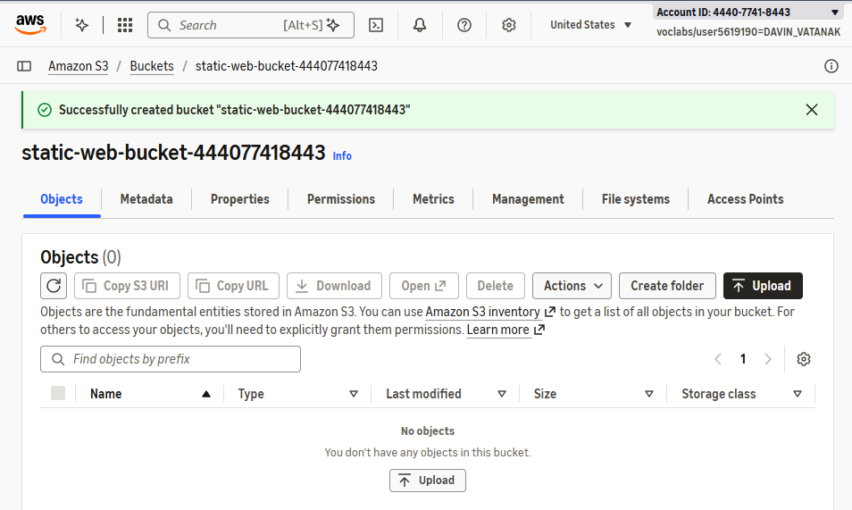
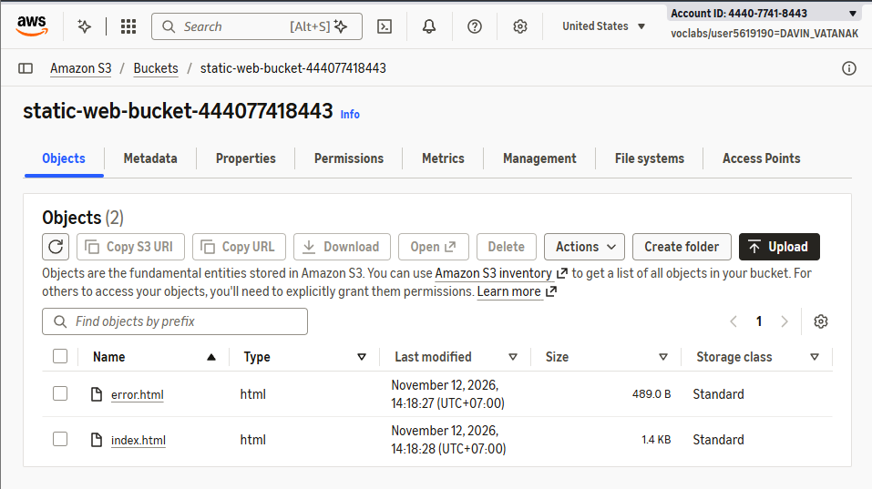
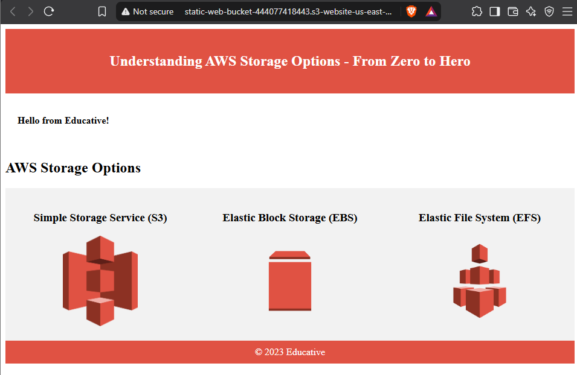
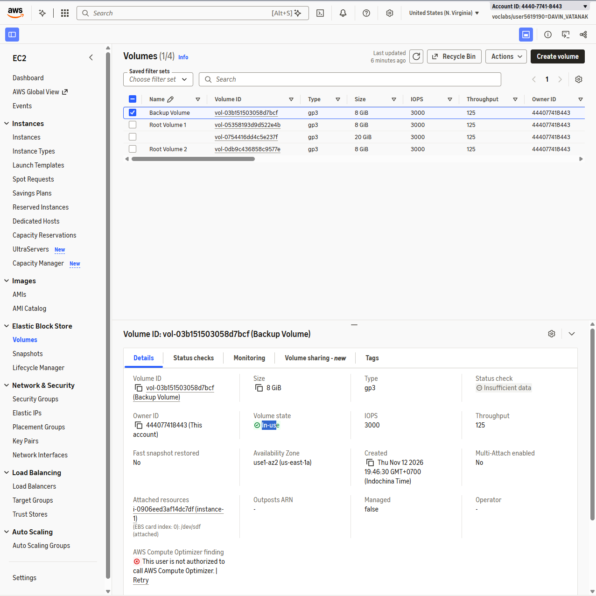
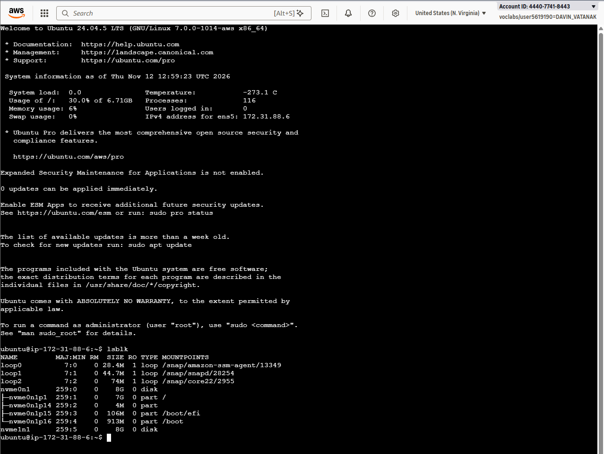
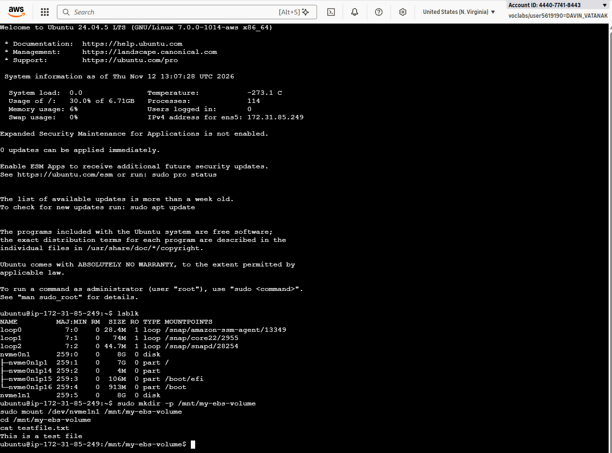
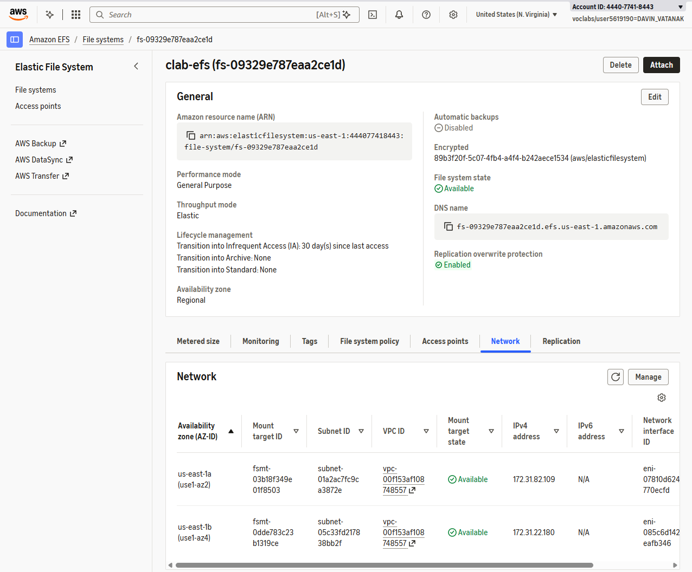
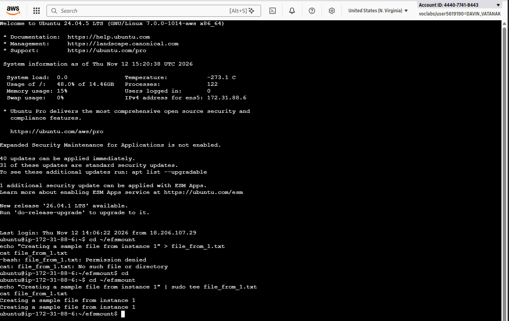
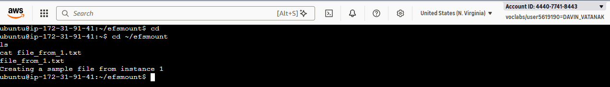

# Cloud Lab 3 Submission — Understanding AWS Storage Options

- **Student name:** Davin Vatanak
- **Student ID:** e20220234
- **Learner Lab user name:** DAVIN_VATANAK
- **Region:** US East (N. Virginia) — `us-east-1`
- **Date completed:** [12.11.26]

---

## Lab objectives

This lab demonstrates how to:

1. Create an S3 bucket, upload objects, and host a static website.
2. Create, attach, format, mount, detach, and move an EBS volume between EC2 instances.
3. Create an EFS file system and share files between two EC2 instances.
4. Compare S3, EBS, and EFS storage services.

## Resources created

| Resource | Configuration |
|---|---|
| S3 bucket | `static-web-bucket-[ACCOUNT_ID]`, public static website hosting |
| S3 objects | `index.html`, `error.html` |
| EC2 security group | `ec2instances-sg`, SSH port 22 from Anywhere-IPv4 |
| EC2 instances | `instance-1`, `instance-2` in `us-east-1a`; `instance-3` in `us-east-1b` |
| EFS security group | `efs-sg`, NFS port 2049 from Anywhere-IPv4 |
| EBS volume | `Backup Volume`, 8 GiB gp3 |
| EFS file system | `clab-efs`, Regional, encrypted, Elastic throughput |
| EFS mount targets | `us-east-1a` and `us-east-1b` |

---

# Part 2.1 — Amazon S3

## Task 1 — Create bucket and upload files

Created an S3 bucket whose name starts with `static-web-bucket`. Block Public Access was disabled because the bucket website requires public object reads. Uploaded these objects:

- `index.html`
- `error.html`





## Task 2 — Static website hosting

Enabled static website hosting with:

```text
Index document: index.html
Error document: error.html
```

Added a bucket policy allowing public `s3:GetObject` access to objects in this bucket:

```json
{
  "Version": "2012-10-17",
  "Statement": [
    {
      "Sid": "Statement1",
      "Principal": "*",
      "Effect": "Allow",
      "Action": "s3:GetObject",
      "Resource": "arn:aws:s3:::static-web-bucket-[ACCOUNT_ID]/*"
    }
  ]
}
```

The website endpoint displayed the uploaded static webpage.



---

# Part 2.2 — Amazon EBS

## Task 3 — EC2 instances and security group

Created security group `ec2instances-sg` with inbound SSH access from Anywhere-IPv4.

Launched two Ubuntu Server 24.04 LTS EC2 instances:

- `instance-1` in `us-east-1a`
- `instance-2` in `us-east-1a`

Both instances use type `t3.medium` and an 8 GiB gp3 root volume.

## Task 4 — EBS volume

Created an 8 GiB gp3 volume named `Backup Volume` in `us-east-1a`. The volume was created in the same Availability Zone as both EC2 instances.

## Task 5 — Attach and mount EBS

Attached `Backup Volume` to `instance-1` as `/dev/sdf`. Linux exposed it as an NVMe device. After checking the device with `lsblk`, formatted and mounted it as an ext4 file system.

Commands used:

```bash
sudo mkfs -t ext4 /dev/nvme1n1
sudo mkdir -p /mnt/my-ebs-volume
sudo mount /dev/nvme1n1 /mnt/my-ebs-volume
cd /mnt/my-ebs-volume
echo "This is a test file" | sudo tee testfile.txt
```





## Task 6 — Move EBS volume

Unmounted and detached `Backup Volume` from `instance-1`. Attached it to `instance-2`, mounted it without formatting, and read the existing file.

```bash
sudo umount /mnt/my-ebs-volume
sudo mkdir -p /mnt/my-ebs-volume
sudo mount /dev/nvme1n1 /mnt/my-ebs-volume
cd /mnt/my-ebs-volume
cat testfile.txt
```

Output:

```text
This is a test file
```

The file remained because additional EBS volumes persist independently from EC2 instances.



---

# Part 2.3 — Amazon EFS

## Task 7 — Create EFS file system

Created security group `efs-sg` with inbound NFS access on port 2049 from Anywhere-IPv4.

Created EFS file system `clab-efs` with these settings:

- Regional file system
- Encryption enabled
- Automatic backups disabled
- Archive transition disabled
- Enhanced performance mode
- Elastic throughput
- Mount targets in `us-east-1a` and `us-east-1b`



## Task 8 — Third EC2 instance

Launched Ubuntu Server 24.04 LTS instance `instance-3` in the default subnet in `us-east-1b`. The instance uses `ec2instances-sg`.

## Task 9 — Mount EFS

Installed `amazon-efs-utils` on `instance-1` and `instance-3`. Mounted `clab-efs` on both instances using the EFS file system ID.

Example mount command:

```bash
sudo mkdir -p /home/ubuntu/efsmount
sudo mount -t efs -o tls fs-[EFS_ID]:/ /home/ubuntu/efsmount
```

## Task 10 — Share a file

Created a file from `instance-1`:

```bash
cd ~/efsmount
echo "Creating a sample file from instance 1" > file_from_1.txt
cat file_from_1.txt
```



Read the same file from `instance-3`:

```bash
cd ~/efsmount
ls
cat file_from_1.txt
```

Output:

```text
Creating a sample file from instance 1
```



---

# Storage comparison

| Feature | S3 | EBS | EFS |
|---|---|---|---|
| Storage model | Object storage | Block storage | File storage |
| Access method | HTTP/API | Attached to one EC2 instance at a time | NFS over network |
| Shared access | Many clients through API | Usually one EC2 instance at a time | Multiple instances simultaneously |
| Scaling | Virtually unlimited object storage | Selectable volume size; resize available | Automatically scales with stored data |
| Availability | Regional service with high durability | Limited to one Availability Zone | Regional; mount targets provide AZ access |
| Common use | Backups, static websites, data lakes | Boot disks, databases, application disks | Shared application files and content |
| Management | No servers or file systems to manage | Manage volume attachment and file system | AWS manages the file system |

## Storage selection

- **S3:** Best for objects, backups, static websites, and data accessed through HTTP or an API.
- **EBS:** Best for low-latency block storage attached to an EC2 instance, such as a boot disk or database disk.
- **EFS:** Best when several EC2 instances need simultaneous access to the same file system.

## Questions

### 1. What is the main difference between S3, EBS, and EFS?

S3 is object storage accessed through an API or HTTP. EBS is block storage attached to an EC2 instance. EFS is shared file storage mounted through NFS.

### 2. Why did the S3 website initially return `403 Forbidden`?

Disabling Block Public Access does not grant object permissions. The bucket also required a bucket policy allowing public `s3:GetObject` access.

### 3. Why must an EBS volume and EC2 instance use the same Availability Zone?

An EBS volume is attached within one Availability Zone. It cannot be directly attached to an instance in another Availability Zone without creating and restoring a snapshot.

### 4. Why did the file remain after moving the EBS volume?

The additional EBS volume persists independently from the EC2 instance. Detaching and reattaching the volume does not erase its file system or data.

### 5. Why was `mkfs` not used when attaching the EBS volume to `instance-2`?

`mkfs` creates a new file system and would erase the existing data. The volume was already formatted, so it only needed to be mounted.

### 6. Why can both EC2 instances access the same EFS file?

EFS is network file storage. Both instances mounted the same file system through EFS mount targets, so they accessed the same shared files.

### 7. Which service is suitable for a static website?

S3 is suitable because it stores website objects and provides static website hosting without requiring an EC2 server.

### 8. Which service is suitable for a database attached to one EC2 instance?

EBS is suitable because databases need low-latency block storage attached to the instance.

### 9. Which service is suitable for shared files used by several EC2 instances?

EFS is suitable because several instances can mount and use the same file system at the same time.

---

# Cleanup

After taking all screenshots, deleted:

- EC2 instances `instance-1`, `instance-2`, and `instance-3`
- EFS file system `clab-efs`
- EBS volume `Backup Volume`
- Security groups `efs-sg` and `ec2instances-sg`
- S3 bucket and its objects
