# Cloud Lab 4 Submission — Amazon VPC

Copy this template to `cc-lab-YOUR_ID/lab4/README.md` in your own repository. Follow [the instructions](lab4-instruction.md). Put your screenshots in `lab4/images/` with the file names below.

- **Student name:** Davin Vatanak
- **Student ID:** e20220234 
- **Learner Lab user name:** DAVIN_VATANAK
- **Date completed:** 19.11.26

---

## VPC and internet gateway

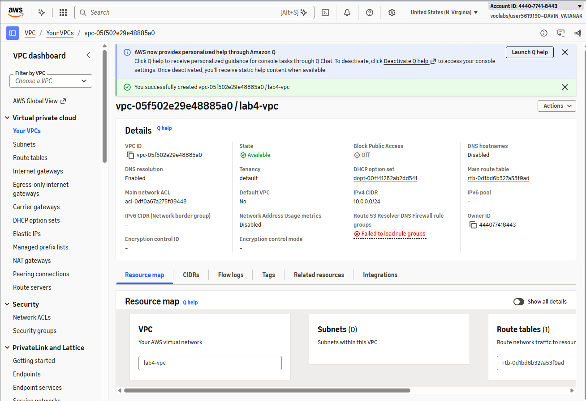

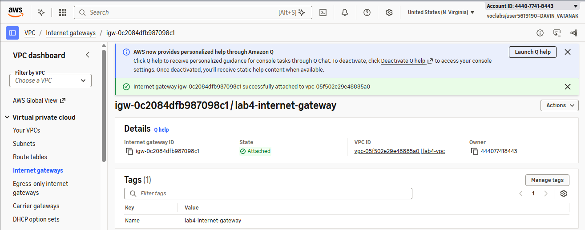

## Public subnet

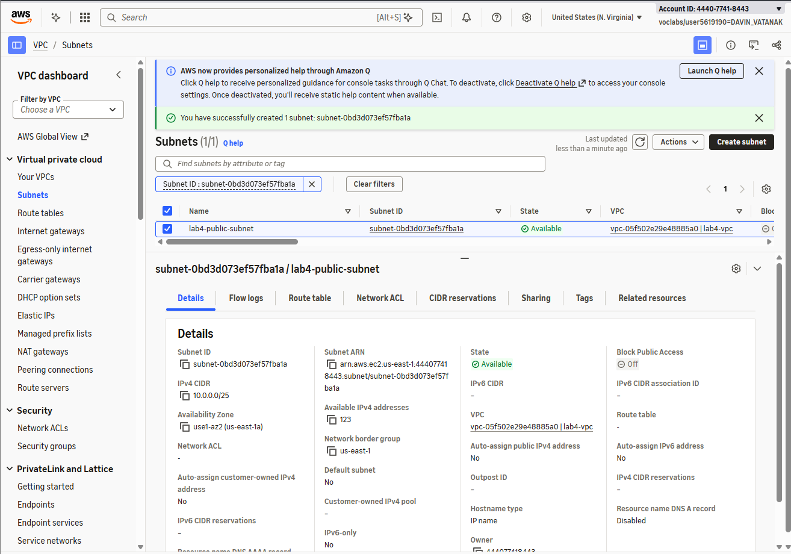

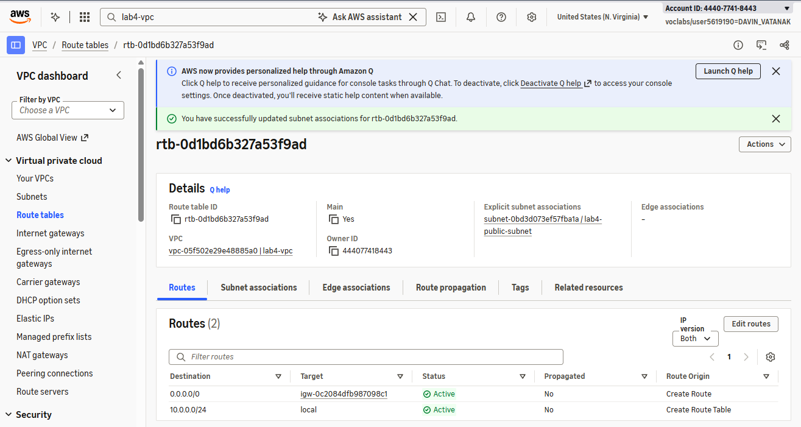

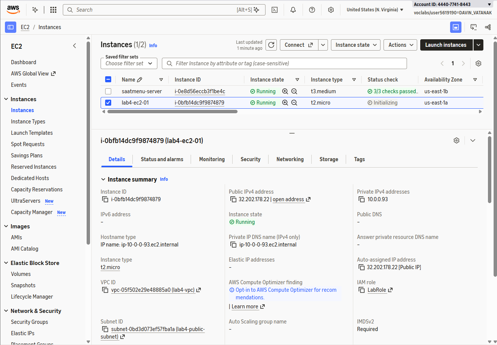

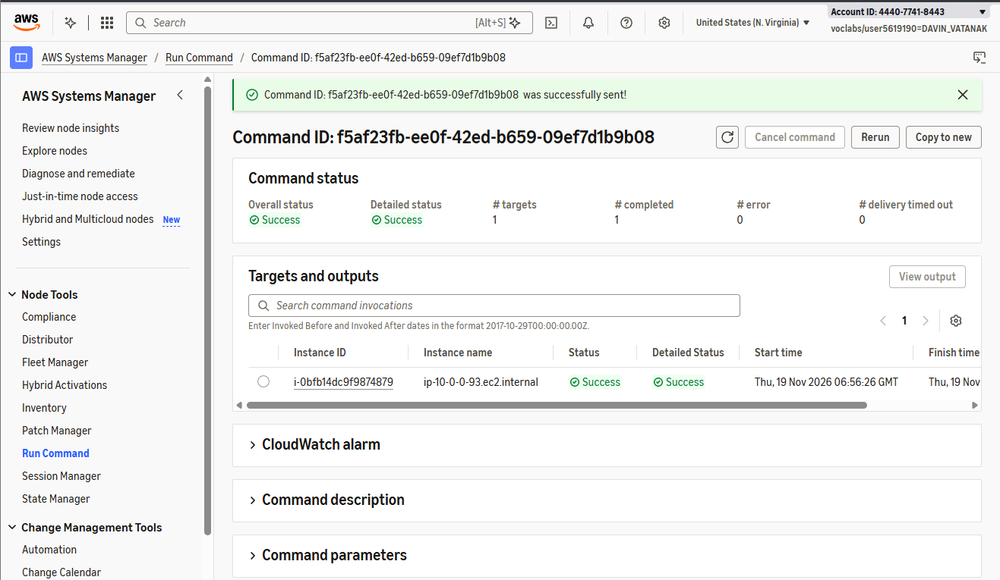

## Private subnet

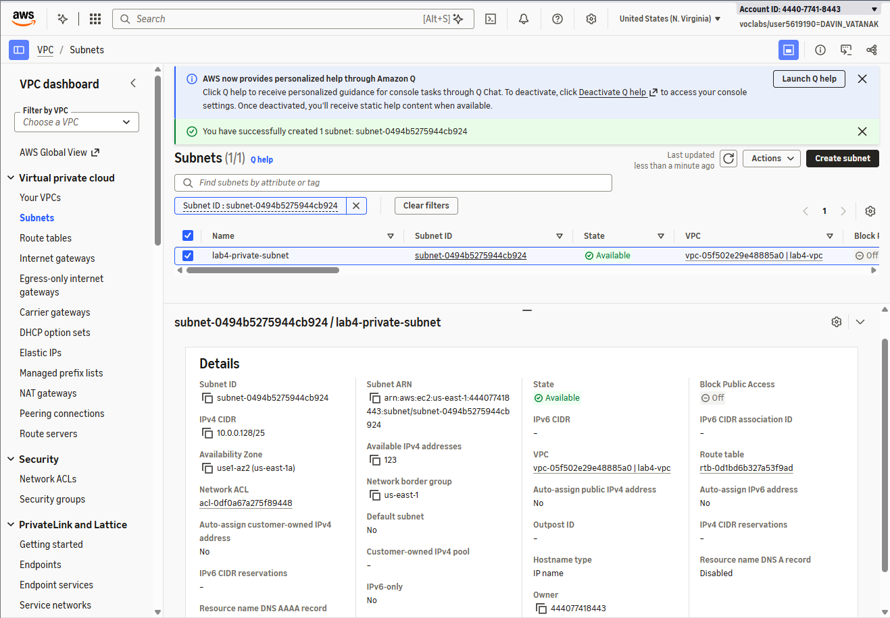

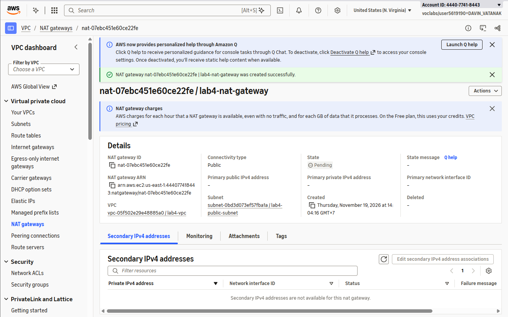

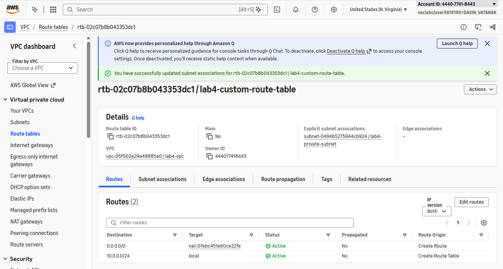

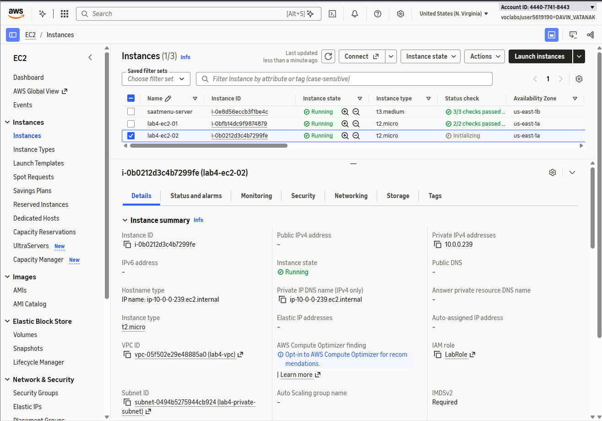

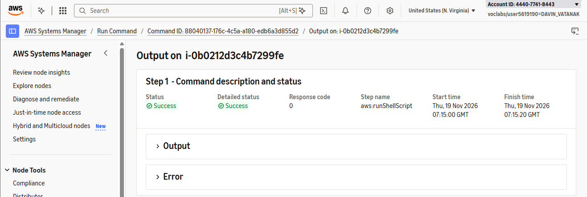

---

## Questions

1. The VPC is `10.0.0.0/24` and the subnets are `10.0.0.0/25` and `10.0.0.128/25`. How many IP addresses does each block contain, and why do the two subnets not overlap?

   A `/24` block contains `2^(32-24) = 256` IP addresses. Each `/25` subnet contains `2^(32-25) = 128` IP addresses, although AWS reserves five addresses in each subnet, leaving 123 usable addresses. The first subnet covers `10.0.0.0`–`10.0.0.127`; the second covers `10.0.0.128`–`10.0.0.255`. Their ranges are adjacent but do not overlap.

2. Both subnets are in the same VPC. What exactly makes `lab4-public-subnet` public and `lab4-private-subnet` private?

   The public subnet's route table sends `0.0.0.0/0` to the internet gateway. Resources there can reach the internet when they also have public IPv4 addresses and suitable security-group rules. The private subnet's route table sends `0.0.0.0/0` to the NAT gateway instead of directly to the internet gateway. It has no direct route to the internet gateway, so it is private.

3. Why is the NAT gateway placed in the **public** subnet and not in the private one?

   A public NAT gateway needs a public IPv4 address and a route to the internet gateway. Placing it in the public subnet gives it both. A NAT gateway in the private subnet would have no direct internet path, so it could not provide outbound internet access for private resources.

4. `lab4-ec2-02` has no public IP address. Can someone on the internet open a connection to it? Can it download updates? Explain both answers.

   No. The instance has no public IP and no inbound route from the internet gateway. The NAT gateway allows outbound connections only; it does not accept unsolicited inbound connections. Yes, it can download updates: the instance sends traffic to the NAT gateway, which uses its public address to reach the internet. Return traffic is allowed for connections initiated by the instance.

5. You tested internet access with Systems Manager instead of SSH. Why did the instances need `LabInstanceProfile` for this?

   `LabInstanceProfile` supplies the instance role with permissions required by the SSM Agent, including `AmazonSSMManagedInstanceCore`. The agent uses these permissions to register the instance with Systems Manager and receive commands and return output. This avoids needing an inbound SSH connection, public IP, or SSH key.

## Problems and how I solved them (optional)

The private instance had no public IP, so I could not test it with direct SSH. I used AWS Systems Manager Run Command instead. After attaching `LabInstanceProfile` to the instances and waiting for the SSM Agent to register, the command completed successfully. I verified the network setup by checking that the public route table pointed to the internet gateway and the private route table pointed to the NAT gateway.

## AI note (optional)

An AI tool suggested that a private instance can download updates through a NAT gateway but cannot receive unsolicited connections from the internet. I checked this by inspecting the private route table and confirming its default route targeted the NAT gateway. I also tested internet access from the instance with Systems Manager Run Command; the command succeeded, confirming outbound access.

## Clean up

- [X] Instances terminated.
- [X] NAT gateway deleted and its Elastic IP released.
- [X] Internet gateway detached and deleted.
- [X] `lab4-vpc` deleted.